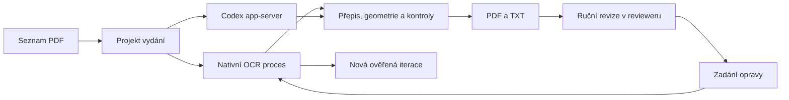

# Nativní aplikace pro OCR a ruční revizi

Stav k 13. 10. 2026: cílové propojení upřesněno v Q15; Q16 určuje nejprve Linux a Q17 nejprve OCR prostředí a proces. Zadavatel v Q18 potvrdil společný návrh a zadal přípravu specifikace. První etapu vymezuje [implementační specifikace](specs/0001-native-ocr-environment.md).

Implementační zadání je publikováno jako [GitHub issue #1](https://github.com/triuk/Rychvald-zpravodaje-OCR/issues/1) se štítkem `ready-for-agent`.

## Potvrzený cíl

Aplikace načte PDF ze složky. Každé vydání tvoří samostatný projekt s vlastním postupem OCR, pracovním přepisem, geometrií, nejasnostmi a výsledky. OCR se spouští z aplikace včetně komunikace s Codexem; poté lze rovnou provést ruční revizi a podle ní vytvořit konečný výstup. Revize tedy nemusí čekat na dokončení celé složky.

Ověřený obsahový postup zůstává v [ocr-workflow.md](ocr-workflow.md). Jeho úplné první čtení, kontroly a datové smlouvy se při začlenění do aplikace zachovají.

## Doporučené prostředí

Pro tento cíl doporučujeme nativní běh bez Dockeru. Jeden uživatelský spouštěč může ovládat několik místních procesů ve společném balíku:

- reviewer a jeho uživatelské rozhraní;
- samostatný nativní OCR proces s ověřenými knihovnami, Tesseractem, jazykovými modely, qpdf, Popplerem a fonty;
- Codex proces pro AI část.

Jeden spouštěč neznamená nutně jediný fyzický soubor: modely, fonty a pomocné programy mohou být součástí přenosného adresáře nebo instalace. Uživatel aplikace nemá ručně vytvářet Python prostředí a dohledávat systémové OCR balíčky. `.venv` zůstává vývojovou pomůckou.

Samostatný OCR proces dovoluje zachovat jeho ověřené závislosti bez vynucení stejného Python prostředí pro reviewer. Aktuální build revieweru používá Python 3.12, OCR prostředí 3.14; jejich sloučení by vyžadovalo nové ověření. Reprodukovatelnost nativního balíku zajistí připnuté vstupy sestavení a manifest verzí a hashů programů, modelů a fontů. Konkrétní balíky se sestavují a ověřují pro cílové platformy.

Docker může případně pomoci při sestavování, ale není požadavkem uživatelského běhu. Nativní sestavení není zárukou totožných PDF bajtů: přijatelný výsledek se ověřuje zachováním obrazu, textem, pořadím a geometrií podle workflow; každá iterace má svou identitu.

## Rozdělení práce

**OCR modul** schová strojové kroky ověřeného workflow za rozhraní pro spuštění, pokračování, stav a aplikaci opravy konkrétního projektu vydání. Používá existující generátor F a datové smlouvy. Zápis přepisu a výstupu projde validací a zachovává předchozí iteraci.

**Reviewer** řídí seznam projektů, průběh, ruční revizi a předání opravy. Dlouhé výpočty běží mimo obsluhu UI; stav a dokončení přicházejí jako stručné události. Při změně výstupu se bezpečně aktualizuje jeho verze a revizní kotvy. Souběžné zapisování stejného projektu agentem a ruční opravou musí koordinovat jeden vykonavatel.

**Codex integrace** vede komunikaci pro konkrétní vydání. Ukládá vazbu projektu na vlákno a dovoluje pokračovat bez opakovaného předávání všech pracovních dat. Přepis a důkazy na disku jsou trvalým stavem projektu; historie chatu je jejich doplňkem.

Jde o návrh vztahů, nikoli tvrzení, že současný reviewer již OCR spouští. Jeho dnešní manifest a kontrolovaný zápis se využijí při návrhu oprav; jejich aktuální smlouvu je nutné převzít ze zdrojů revieweru.

## Doporučené propojení s Codexem

Pro vestavěnou konverzaci navrhujeme místní `codex app-server` přes standardní vstup a výstup. Oficiální rozhraní podporuje vytvoření a obnovení vláken, zahájení a přerušení tahů, průběžné zprávy a požadavky na schválení. Dokumentuje také událost `thread/tokenUsage/updated`. Viz [OpenAI: Codex App Server](https://learn.chatgpt.com/docs/app-server).

Pro místní použití lze využít přihlášení Codexem k účtu ChatGPT; přístup přes API klíč je jiný režim účtování. Konkrétní přihlašovací integrace a oprávnění se ověří před implementací; přístup k účtu nebo modelu se nepředpokládá z pouhé instalace programu. Viz [OpenAI: Authentication](https://learn.chatgpt.com/docs/auth).

Lokálně byl ověřen příkaz `codex app-server --help`; server ani přihlášení se v tomto návrhovém průchodu nespouštěly. Pro implementaci je třeba vybrat a ověřit konkrétní verzi protokolu, nikoli záviset na libovolné aktualizaci Codexu.

## Úspora tokenů

- Strojové kroky, evidence, cache, validace a export jsou místní výpočty.
- Codex čte jen kontext daného vydání; velké JSON soubory a úplné diagnostiky zůstávají na disku a nástroje vracejí malé výběry nebo souhrny.
- První čtení zůstává úplné. Opravy navazují na potvrzený přepis a načítají dotčené řádky a jejich okolí.
- Přesné znění zadané uživatelem se předá jako strukturovaná oprava. Samotné přepsání zadaného slova nevyžaduje další jazykový odhad; AI se použije pro úlohy, které úsudek skutečně potřebují.
- Obnovení po přerušení používá uložené podklady a správně identifikovanou cache. Přepnutí na jiné PDF nezačíná společnou konverzaci o všech vydáních.
- Při dostupných údajích Codexu evidovat skutečnou spotřebu podle projektu a kroku. Krátká odpověď sama neprokazuje nízkou spotřebu.

## Rozhodnutí o etapách

- **Q16:** nejprve Linux, následně Windows. První implementace ověří konkrétní podporované Linux prostředí; podporu jiných distribucí nebo Windows nelze prohlásit jen podle společné datové smlouvy.
- **Q17:** nejprve reprodukovatelné nativní OCR prostředí, obnovení běhu a rozhraní OCR procesu. Rozšíření revieweru o spouštění OCR, vestavěnou Codex komunikaci a opravy z UI je navazující etapa.

## Potvrzený souhrn první etapy

První etapa proběhne v projektu `Rychvald-zpravodaje-OCR`. Jejím výsledkem je obnovitelné místní OCR pracoviště na Linuxu, připravené pro pozdější ovládání z revieweru:

1. **Nativní prostředí:** připnuté knihovny a verzovaná sada systémových OCR programů, českého modelu a fontů. Instalační/sestavovací postup a manifest verzí a hashů doplní kontrola očekávaného prostředí. Běžný běh nevyžaduje Docker.
2. **Projekt vydání:** jedno zdrojové PDF, stabilní identita zdroje, vlastní pracovní data, potvrzený přepis, historie a výsledky. Produkční složky jsou navržené jako `input/`, `work/<identifikátor>/`, `output/pdf/` a `output/text/`; aktuální prototypové podklady se zachovají.
3. **Pokračování a cache:** obnovit přerušený úvodní běh, uchovat již dokončené kroky a opravy. Do identity OCR zahrnout hash modelu. Změněný či poškozený podklad se ověří a zpracuje znovu jen v potřebném rozsahu.
4. **Rozhraní procesu:** explicitní vstupy a pracovní cesty, spuštění/pokračování, stav a strukturované opravy. Stručné výsledky a stabilní význam návratových stavů dovolí pozdější ovládání z aplikace; není cílem znovu implementovat existující OCR algoritmy.
5. **Nízká spotřeba tokenů:** velké podklady a historie zůstávají na disku, opravy se předávají dávkově přes existující datové smlouvy. Agent načítá potřebné úseky; první vizuální čtení a povinné kontroly z ověřeného workflow zůstávají úplné. Integrace skutečného měření tokenů z Codex app-server patří do navazující etapy.
6. **Ověření:** z čistého prostředí provést malý integrační průchod na syntetickém skenu, přerušení a pokračování, invalidaci cache po změně vstupů/modelu a zachování oprav. Zkontrolovat původní obraz, extrakci, geometrii a shodu PDF/TXT podle ověřených smluv. Neopakovat celý již provedený obsahový prototyp bez důvodu.

Čistá instalace, obnovení běhu a povinné kontroly musí projít před označením prostředí za připravené. Otevřené obsahové nálezy a přijetí konkrétních zpravodajů se stále řídí `ocr-workflow.md`; připravené prostředí neznamená schválení všech budoucích PDF.

První etapa připraví podklady pro navazující reviewer. Jeho UI a vestavěná Codex komunikace se nyní nemění. Stávající uživatelské změny v OCR nástrojích, testech a datových smlouvách jsou výchozím stavem, nikoli změnami určenými k vrácení.

Q18 společný návrh uzavírá. Konkrétní kritéria a rozsah implementace jsou v [specifikaci první etapy](specs/0001-native-ocr-environment.md); podrobnosti balení a rozhraní se při implementaci ověří proti aktuálním nástrojům a technickým možnostem Linuxu.
